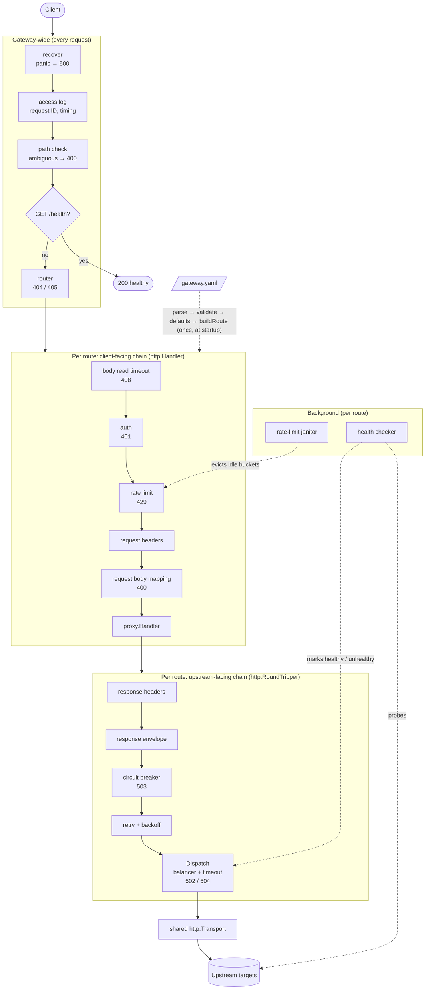

# GatewayKit

A lightweight, config-driven API gateway written in Go. It reads a YAML config file and handles the traffic between clients and a set of upstream services:
- routing
- rate limiting
- authentication
- request and response transforms
- load balancing
- retries
- circuit breaking
- health checks

The proxy logic is built by hand on the standard library's `net/http`, without `httputil.ReverseProxy` or any proxy or gateway framework.

For the reasoning behind the design, including the priorities, trade-offs and ambiguous parts of the spec, see **[DECISIONS.md](DECISIONS.md)**.

## Prerequisites

- **Go 1.27 or newer** ([install](https://go.dev/dl/)).
- **`make`** (optional). Every `make` target below also has a plain `go` command.

The only third-party dependency is `gopkg.in/yaml.v3`, which Go downloads automatically the first time you build or test.

## Running the gateway

The example config `gateway.yaml` points at upstreams on ports 3001–3006. A mock upstream server is included so you can run the whole thing locally. Use two terminals:

```sh
# Terminal 1: start mock upstreams on :3001-3006
make mock                 # or: go run ./cmd/mockupstream

# Terminal 2: start the gateway on :8080 with gateway.yaml
make run                  # or: go run ./cmd/gateway gateway.yaml
```

### Choosing a config file

The config path is resolved in this order:

```sh
go run ./cmd/gateway -config path/to/config.yaml       # 1. -config flag
go run ./cmd/gateway path/to/config.yaml               # 2. first argument
GATEWAY_CONFIG=path/to/config.yaml go run ./cmd/gateway # 3. environment variable
go run ./cmd/gateway                                   # 4. defaults to ./gateway.yaml
```

With make: `make run CONFIG=path/to/config.yaml`.

**An invalid config stops the gateway at startup** with a non-zero exit code. It lists every problem it found and where, for example:

```
invalid config bad.yaml:
routes[0].path: must start with "/", got "x"
routes[0].methods[0]: unknown HTTP method "FETCH"
routes[0].upstream: one of url or targets is required
```

### Trying it out

With the mock upstreams and the gateway running:

```sh
# Health check: always available
curl localhost:8080/health
# {"status":"healthy","uptime_seconds":12}

# Proxying: the mock upstream echoes back what it received
curl localhost:8080/api/users/42

# 404 for unknown paths, 405 for methods the route doesn't allow
curl localhost:8080/nope
curl -X POST localhost:8080/api/products

# strip_prefix + weighted load balancing (3:1 across :3003 and :3004)
curl localhost:8080/api/products/123

# API key auth: 401 without a valid key
curl localhost:8080/api/internal
curl -H 'X-API-Key: sk_live_abc123' localhost:8080/api/internal

# Rate limiting: the 11th request inside 10s gets a 429
for i in $(seq 11); do curl -s -o /dev/null -w '%{http_code} ' localhost:8080/api/orders; done

# Request and response transforms: body mapping, header rules, response envelope
curl -X POST localhost:8080/api/legacy/v1/data \
  -H 'Content-Type: application/json' \
  -d '{"userId": 42, "userName": "ada"}'
```

You can control the mock upstream with query parameters to simulate failures:

| Parameter | Effect | Example |
|---|---|---|
| `?status=503` | Respond with that status | `curl 'localhost:8080/api/orders?status=503'`: the gateway retries with exponential backoff, then returns the 503 |
| `?delay=11s` | Wait before responding | `curl 'localhost:8080/api/products/1?delay=11s'`: exceeds the route's 10s timeout, so the gateway returns 504 |
| `?fail_rate=0.5` | Return a 503 on half of all requests, at random | Simulates a flaky service |

To trip the circuit breaker, send 5 failing requests and then a good one:

```sh
for i in $(seq 5); do curl -s -o /dev/null -H 'X-API-Key: sk_live_abc123' 'localhost:8080/api/internal?status=500'; done
curl -H 'X-API-Key: sk_live_abc123' localhost:8080/api/internal
# {"error":"service_unavailable","retry_after":30}
```

The gateway logs JSON to stderr: one line per request (with request ID, route, status and duration), plus events such as retries, circuit breaker state changes and targets going unhealthy. Ctrl-C shuts it down gracefully, letting in-flight requests finish first.

## Running the tests

```sh
make test                 # or: go test -race ./...
```

The tests need no setup. They start mock upstreams in-process on random ports and build gateways from inline YAML, so nothing has to be running and nothing depends on the example config. `-race` turns on Go's race detector, which matters for the concurrency tests, such as 50 simultaneous requests against a rate limit of 10.

Run a single test or package:

```sh
go test -race ./internal/gateway -run TestRateLimitUnderConcurrency
go test -race ./internal/ratelimit
```

## Implemented config features

Every field in the config schema is implemented. DECISIONS.md explains how the ambiguous ones were interpreted.

**Gateway**
- [x] `GET /health`: always available, returns `{"status":"healthy","uptime_seconds":N}`
- [x] `gateway.port`
- [x] `gateway.global_timeout`: the default upstream timeout, which a route can override
- [x] `gateway.global_rate_limit`: the default limit for routes that don't set their own; each route gets its own counters

**Routing and proxying**
- [x] `routes[].path`: longest-prefix match on path segments (`/api/users` matches `/api/users/1`, not `/api/usersX`)
- [x] `routes[].methods`: 405 with an `Allow` header for other methods; unmatched paths get 404
- [x] `routes[].strip_prefix`
- [x] `upstream.url`, or `upstream.targets` with `weight`
- [x] `upstream.timeout`: 504 on timeout, 502 if the upstream can't be reached
- [x] `upstream.balance`: `round_robin` and `weighted_round_robin` (smooth weighted round robin)

**Rate limiting**
- [x] `rate_limit.strategy`: `fixed_window` and `sliding_window`
- [x] `rate_limit.per`: `ip` and `global`
- [x] 429 with a `Retry-After` header and `retry_after` in the body

**Resilience**
- [x] `retry`: `attempts`, `backoff` (`fixed` or `exponential`), `initial_delay`, and `on` (which status codes to retry)
- [x] `circuit_breaker`: `threshold`, `window` and `cooldown`; when open it returns 503 `{"error":"service_unavailable","retry_after":N}`
- [x] `health_check`: `path`, `interval` and `unhealthy_threshold`; unhealthy targets are skipped by the load balancer

**Security**
- [x] `auth` with `type: api_key`: the key is read from the configured `header` and checked against `keys`

**Transforms**
- [x] `request_transform.headers`: `add` and `remove`
- [x] `request_transform.body.mapping`: dot-path restructuring of the request body
- [x] `response_transform.headers`: `add` and `remove`
- [x] `response_transform.body.envelope`: wraps the upstream response
- [x] Variables: `$request_time`, `$response_time`, `$route_path`, `$body` and `$literal:<value>`

## Architecture



Each route's pipeline is built **once at startup** from the config, as two decorator chains:
- **Client-facing (`http.Handler`):** policies that can reject a request before any upstream call.
- **Upstream-facing (`http.RoundTripper`):** policies that need to see the upstream's response or error.

`proxy.Handler` bridges the two and is the one place errors become JSON responses. The labels on each stage show the status it can return. Responses travel back up the same chain. [DECISIONS.md](DECISIONS.md#architecture) explains why the stages are in this order.

## Project layout

```
cmd/gateway/          entry point: config loading, HTTP server, graceful shutdown
cmd/mockupstream/     mock upstream servers for local runs
internal/config/      YAML schema, validation, defaults
internal/gateway/     builds each route's pipeline from config; end-to-end tests
internal/router/      route matching, 404/405
internal/proxy/       hand-written forwarding (headers, bodies, error mapping)
internal/upstream/    load balancing, retries, circuit breaker, health checks
internal/middleware/  rate limiting and API key auth
internal/ratelimit/   fixed- and sliding-window limiters
internal/transform/   header and body transforms, $variables
internal/httperr/     the one JSON error format every layer uses
internal/mockupstream/ the mock upstream, shared by tests and cmd/mockupstream
```
